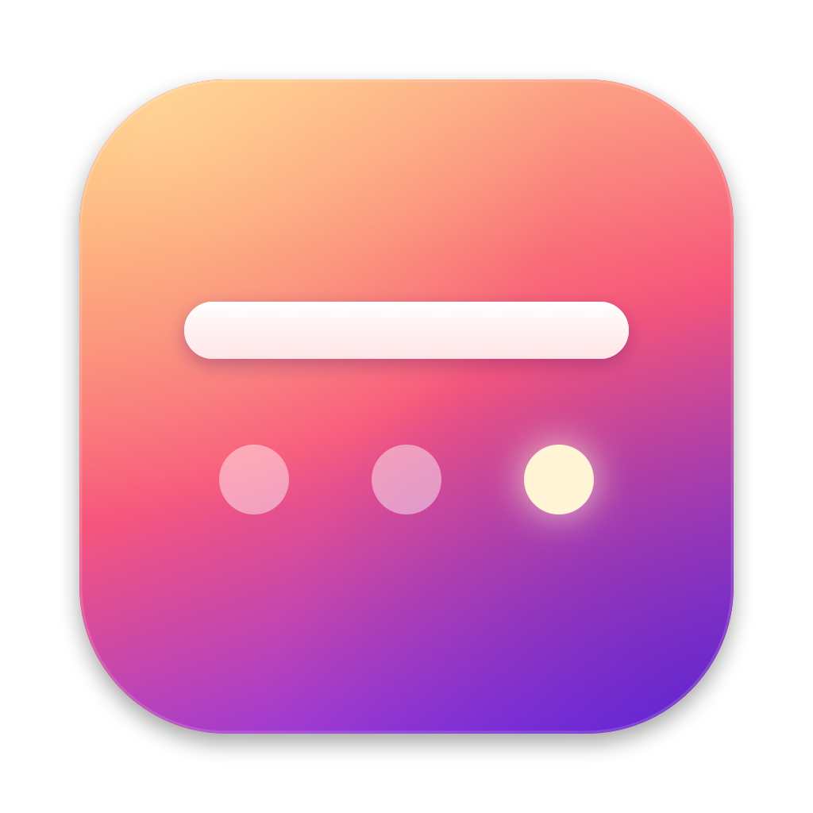
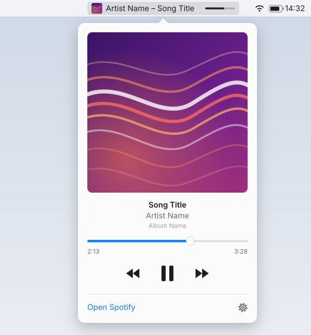

<p align="center">
  
</p>

# MenuBarKit

A personal, modular macOS menu bar app. Each feature is a module that can be
switched on and off in Settings.

**Modules**

- **Spotify** — current track in the menu bar (album art, artist – title, time,
  progress bar; every element optional and reorderable). Click for a popover with
  artwork, a seekable progress bar and playback controls.

  

  <sub>Illustration with placeholder track data.</sub>

- **Input** (off by default) — reverses the mouse wheel (vertical and horizontal
  separately) while the trackpad keeps natural scrolling. Needs the Accessibility
  permission; only scroll events are watched.

Right-click any MenuBarKit item for Settings and Quit. Opening the app again from
Spotlight also opens Settings.

## Install

Requires macOS 14+ and the Command Line Tools (`xcode-select --install`).

```bash
git clone https://github.com/Tvrtk0/MenuBarKit.git ~/dev/projects/MenuBarKit
~/dev/projects/MenuBarKit/install.sh
```

`install.sh` creates a local self-signed code signing certificate (once per Mac),
builds a release, copies it to `/Applications` and launches it. Signing with a
stable certificate means macOS remembers the Spotify (Automation) permission across
rebuilds. No Apple Developer account or notarization is involved — the app is
built locally, so Gatekeeper never quarantines it.

## Updating

The app checks GitHub once a day. When the `main` branch is ahead of the commit it
was built from, Settings and the Spotify popover show **Update available**;
clicking it runs `make update` in the checkout the app was built from (pull, build,
reinstall, relaunch). Output goes to `~/Library/Logs/MenuBarKit/update.log`.

By hand:

```bash
make update     # git pull + install
make install    # build + copy to /Applications + relaunch
make run        # build + launch from build.noindex/ without installing
make uninstall
```

## Layout

```
Sources/MenuBarKit/
  App/        entry point, app delegate
  Core/       module protocol + manager, status item host, settings window, updater
  Modules/    one folder per module
Support/      Info.plist template (filled in by scripts/bundle.sh), app icon (scripts/make-icon.swift)
scripts/      bundling, signing, quitting the running app
```

Adding a module: implement `MenuBarModule`, use `StatusItemController` for its menu
bar item, and register it in `AppServices`.
